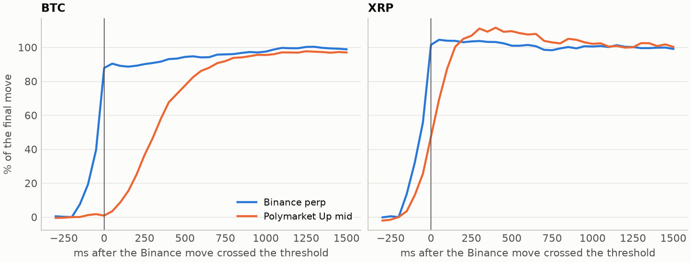
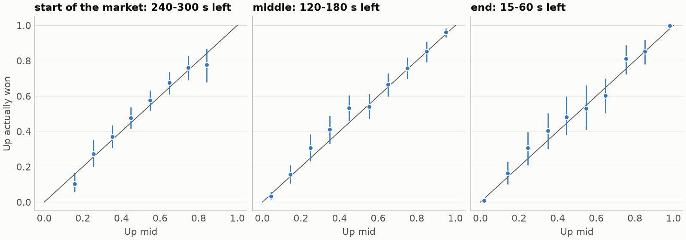
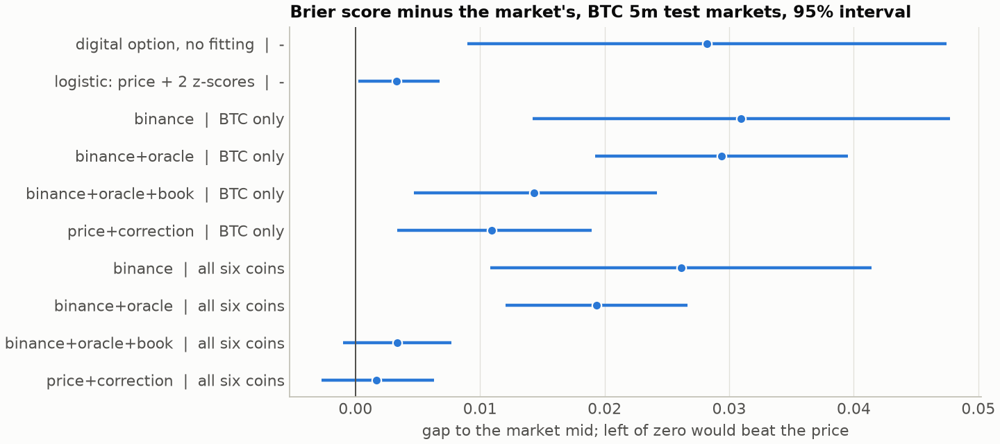

# Polymarket up/down research

How fast does Polymarket follow Binance? Is its price a fair probability? Can a small model beat it?

Two notebooks answer these questions on one full day of Polymarket 5- and 15-minute crypto markets, recorded alongside Binance, Bybit, OKX, Coinbase and the Chainlink oracle. The day is a free dataset on Hugging Face, so everything here can be rerun without an account.

The lag measurement also has a [short write-up on keydata.shop](https://keydata.shop/research/polymarket-binance-lag).

## Findings

All numbers describe one day, 2026-10-20: 2,304 markets across BTC, ETH, SOL, XRP, DOGE and BNB.

**Polymarket follows Binance in a few hundred milliseconds.** After a sharp Binance perpetual move, the BTC Up mid covers half of its response in 350-400 ms. Other coins take 50-250 ms, depending on the coin and the clock. One-second bars cannot show this, so this part uses raw ticks.



**Markets settle on an average, not on the price you are watching.** Comparing Chainlink's 60-second TWAP at the end and the start reproduces 2,289 of 2,292 outcomes. Reading the direction off Binance gets about one market in eight wrong.

**The price is a fair probability.** Realised frequencies sit on the diagonal at every stage of a market.



**Liquidity is thin and taking is expensive.** The median best bid plus best ask on BTC adds up to 442 USDC. A share taken at 50c costs at least 2.25c, and 1.75c of that is the fee.

**A small model does not beat the price.** Across 64 LightGBM configurations, the closest selected model tied the market within error. Training on all six coins beat training on BTC alone, and hyperparameters hardly mattered.



## Notebooks

| Notebook | Contents |
|---|---|
| [01_market_statistics](notebooks/01_market_statistics.ipynb) | Settlement, lead-lag from one second down to 50 ms, oracle delay, calibration, liquidity, costs, intraday rhythm |
| [02_model_training](notebooks/02_model_training.ipynb) | LightGBM and baselines, walk-forward validation, BTC only vs six coins, parameter grid, feature importance |

Both are committed with their outputs, so they can be read on GitHub without running anything.

## Run it

Python 3.12. About 1.1 GB of data is downloaded on the first run.

```bash
python -m venv .venv
source .venv/bin/activate
pip install -r requirements.txt
make notebooks   # a few minutes after the download
make test
```

The tick-level results in `results/` come from raw data, which is much larger, so they are built by a separate step:

```bash
python scripts/build_tick_lag.py               # six coins, about 7 GB
python scripts/build_tick_lag.py --coins btc   # one coin, about 2 GB
```

## Data

The data comes from [keydata.shop](https://keydata.shop). This day is free under CC BY 4.0.

| Coin | 1-second aggregates | Raw ticks |
|---|---|---|
| BTC | [dataset](https://huggingface.co/datasets/RabbitGo777/polymarket.btc_20261020.v4.1s.parquet) | [dataset](https://huggingface.co/datasets/RabbitGo777/polymarket.btc_20261020.v4.parquet) |
| ETH | [dataset](https://huggingface.co/datasets/RabbitGo777/polymarket.eth_20261020.v4.1s.parquet) | [dataset](https://huggingface.co/datasets/RabbitGo777/polymarket.eth_20261020.v4.parquet) |
| SOL | [dataset](https://huggingface.co/datasets/RabbitGo777/polymarket.sol_20261020.v4.1s.parquet) | [dataset](https://huggingface.co/datasets/RabbitGo777/polymarket.sol_20261020.v4.parquet) |
| XRP | [dataset](https://huggingface.co/datasets/RabbitGo777/polymarket.xrp_20261020.v4.1s.parquet) | [dataset](https://huggingface.co/datasets/RabbitGo777/polymarket.xrp_20261020.v4.parquet) |
| DOGE | [dataset](https://huggingface.co/datasets/RabbitGo777/polymarket.doge_20261020.v4.1s.parquet) | [dataset](https://huggingface.co/datasets/RabbitGo777/polymarket.doge_20261020.v4.parquet) |
| BNB | [dataset](https://huggingface.co/datasets/RabbitGo777/polymarket.bnb_20261020.v4.1s.parquet) | [dataset](https://huggingface.co/datasets/RabbitGo777/polymarket.bnb_20261020.v4.parquet) |

One day cannot prove much. The full archive starts on 2026-03-24 and uses the same file format, so this code runs on any other day: put the files in `data/agg`, change `DAY` in `pmlab/data.py` and skip `download_agg()`. Before 2026-08-14 the 5-minute markets settled on `twap_30s`, so use that column on earlier days.

- [Column reference](https://keydata.shop/data/agg)
- [Shorter free samples](https://keydata.shop/samples)
- [BTC 5-minute aggregates](https://keydata.shop/t/agg-btc-5m) and [raw ticks](https://keydata.shop/t/raw-btc-5m)

## How the results stay honest

- **No lookahead.** Features use only bars that have closed. Chainlink values are joined on when they arrived, not on their round time. Tests cover both.
- **Whole markets.** A market belongs to one side of each split, and later markets are only ever tested on earlier ones.
- **Realistic uncertainty.** Rows of one market share one outcome, and coins move together, so intervals resample opening times and not rows.
- **No selection on the test set.** Each reported model was chosen on validation log loss.

## Layout

```
notebooks/   the two notebooks, with outputs
pmlab/       loading, features, models, statistics, chart style
scripts/     tick-level lag study on raw data
results/     tables written by the notebooks and the script
figures/     charts written by the notebooks
tests/       checks for lookahead, splits and scoring
```

## Limits

This is one day, so regimes, outages and holidays are not represented. The models use 1 s aggregates, so they say nothing about an edge at the sub-second speed measured on raw ticks. Nothing here simulates order fills, and a mid moving is not money made. This is research and not financial advice.

## License

Code: [MIT](LICENSE). Data: [CC BY 4.0](https://creativecommons.org/licenses/by/4.0/), crediting keydata.shop. Polymarket, Binance, Bybit, OKX, Coinbase and Chainlink are their owners' marks, and this project is not affiliated with them.
